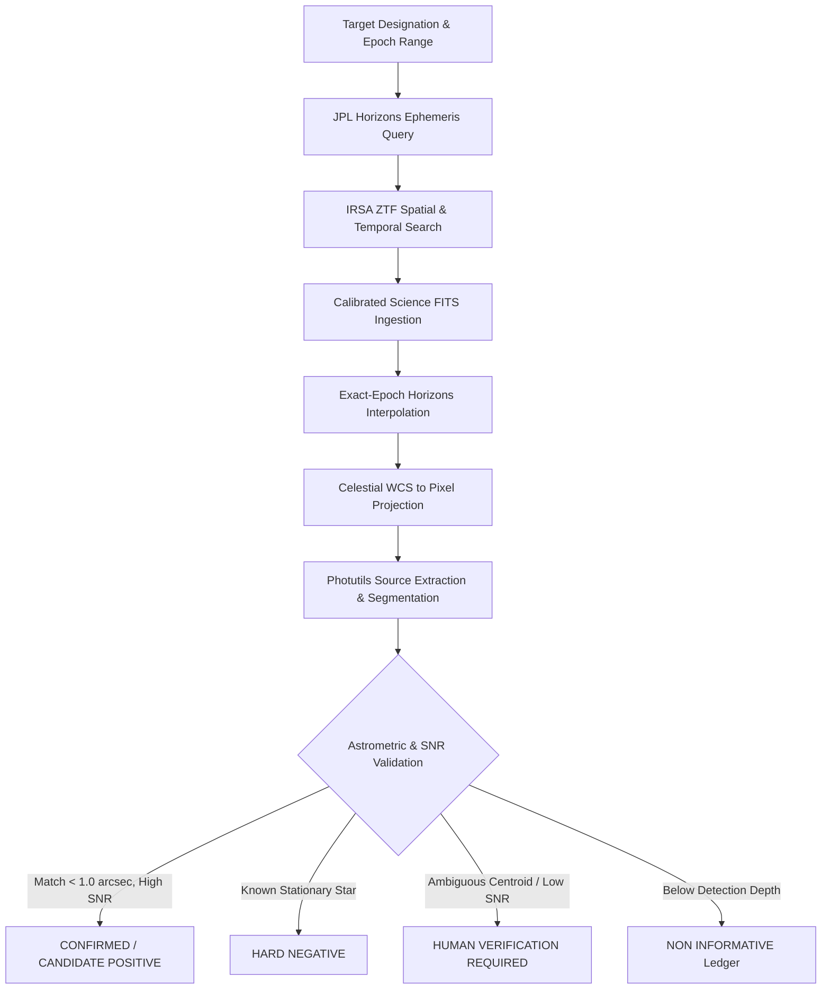

# ASTRION 🪐

**Automated Solar System Object Acquisition, Astrometric Localization, and Dataset Verification Pipeline**

[](https://www.python.org/downloads/)
[](https://www.astropy.org/)
[](https://irsa.ipac.caltech.edu/)
[](https://ssd.jpl.nasa.gov/horizons/)
[]()

---

## Overview

**ASTRION** is a scientific data acquisition and processing engine that bridges high-precision Solar System dynamics with time-domain astronomical survey archives. By querying **JPL Horizons** on demand for exact shutter-open epochs (`OBSJD`) and matching against the **Zwicky Transient Facility (ZTF)** archive at NASA/IPAC IRSA, ASTRION reliably locates, extracts, and validates small-body astronomical detections in calibrated FITS exposures.

The system is designed specifically for building high-integrity training and benchmark datasets for moving-object machine learning models, enforcing sub-arcsecond astrometric tolerances, rigorous SNR thresholds, and transparent provenance tracking.

---

## Scientific Methodology & Architecture



1. **Sub-Second Ephemeris Interpolation**: Eliminates coarse-grid interpolation errors by querying JPL Horizons for the exact fraction-of-a-day shutter-open timestamp (`OBSJD`) found in each ZTF image header.
2. **Sub-Arcsecond Astrometric Precision**: Projects celestial coordinates $(RA, Dec)$ into detector coordinates $(x, y)$ using full celestial World Coordinate Systems (WCS).
3. **Morphological Extraction**: Employs `photutils.segmentation` and `DAOStarFinder` with dynamic trail-length compensation to separate true moving targets from background stationary stars and noise artifacts.
4. **Strict Quality Gates**: Categorizes candidate cutouts into `CONFIRMED_POSITIVE`, `CANDIDATE_POSITIVE`, `HARD_NEGATIVE`, and `HUMAN_VERIFICATION_REQUIRED`. Unobservable noise epochs ($V > \text{MAGLIM}$) are routed to dedicated `NON_INFORMATIVE` ledgers without corrupting training distributions.
5. **Campaign Guardrails & Invariants**: Enforces SHA-256 production dataset checksum verification, single-instance process locking, rate-limiting token buckets, exponential backoff, and circuit breakers for 5xx archive errors.

---

## Supported Small-Body Targets

ASTRION has been verified across multiple dynamical populations:

| Target | Orbit Class | Typical Magnitude ($V$) | Dataset Role |
| :--- | :--- | :---: | :--- |
| **1 Ceres** | Main-Belt Asteroid / Dwarf Planet | $7.0 - 9.0$ | Primary benchmark / Train |
| **2 Pallas** | Main-Belt Asteroid (B-type) | $9.0 - 10.5$ | Primary benchmark / Train |
| **4 Vesta** | Main-Belt Asteroid | $5.5 - 8.5$ | Bright reference / Train |
| **433 Eros** | Near-Earth Asteroid (Amor) | $10.0 - 15.0$ | Moderate NEO / Validation |
| **65803 Didymos** | Near-Earth Asteroid (Apollo) | $15.5 - 21.0$ | Faint NEO / Test |
| **99942 Apophis** | Near-Earth Asteroid (Aten) | $16.0 - 21.5$ | Hazardous NEO / Train |
| **101955 Bennu** | Near-Earth Asteroid (Apollo) | $21.5 - 23.8$ | Archival depth limit testing |
| **C/2020 F3 (NEOWISE)** | Long-Period Comet | Variable | Diffuse morphology probe |

---

## Repository Structure

```text
ASTRION/
├── docs/                      # Architectural specifications & mission audits
│   ├── COVERAGE_AND_LIMITATIONS.md
│   ├── DATA_MODEL.md
│   ├── EVIDENCE_RESOLUTION.md
│   ├── INGESTION_ARCHITECTURE.md
│   └── LOCALIZATION_REPORT.md
├── src/                       # Core pipeline source code
│   ├── ingestion/             # Modular connectors (ZTF, Horizons, SIMBAD, MAST)
│   │   ├── base.py
│   │   ├── jpl_horizons.py
│   │   ├── registry.py
│   │   └── ztf.py
│   ├── budget.py              # Request throttling and circuit breakers
│   ├── dataset_generator.py   # Full FITS cutout and segmentation engine
│   └── resolver.py            # Ephemeris-to-observation evidence resolver
├── tests/                     # Unit and integration test suite (45 tests)
│   ├── test_atomic_save.py
│   ├── test_bottleneck_fix.py
│   ├── test_localization_exact.py
│   ├── test_phase2_hardening.py
│   ├── test_refactor_discovery.py
│   ├── test_staging_safeguards.py
│   └── test_ztf_where.py
├── tools/                     # Operational automation scripts
│   ├── audit_staging.py       # Comprehensive dataset integrity auditor
│   ├── probe_discovery.py     # Ephemeris / observation intersection probe
│   ├── run_campaign.py        # Safe bounded batch campaign runner
│   └── run_campaign.ps1       # PowerShell execution wrapper
├── probe.py                   # Phase 0 validation probe
├── data_sources.yaml          # Registry of astronomical databases & APIs
├── pytest.ini                 # Test configuration
└── requirements.txt           # Python dependencies
```

---

## Installation & Setup

### Prerequisites
- Python 3.10 or higher
- Git

### Quickstart

1. **Clone the repository:**
   ```bash
   git clone https://github.com/devanshi442/ASTRION.git
   cd ASTRION
   ```

2. **Create and activate a virtual environment:**
   ```bash
   python -m venv .venv
   # On Windows:
   .venv\Scripts\activate
   # On macOS/Linux:
   source .venv/bin/activate
   ```

3. **Install dependencies:**
   ```bash
   pip install -r requirements.txt
   ```

---

## Running Tests

ASTRION includes a comprehensive test suite covering metadata caching, atomic manifest serialization, rate-limiting token buckets, circuit breakers, and astrometric projections.

Run the test suite offline:
```bash
pytest
```

To run tests including those marked for live network access:
```bash
pytest -m "live_network or not live_network"
```

---

## Operational Tools

### Automated Campaign Runner
To execute bounded sample acquisition batches safely without exceeding archive quotas:

```bash
python tools/run_campaign.py \
    --max_campaign_hours 3.0 \
    --max_batches 10 \
    --max_total_samples 30 \
    --batch_max_samples 5 \
    --batch_max_seconds 600 \
    --batch_max_requests 100 \
    --batch_workers 2 \
    --cooldown_seconds 300 \
    --staging_dir data/staging_work
```

### Dataset Integrity Audit
To audit a dataset staging directory for manifest consistency, orphan cutouts, WCS validity, and file integrity:

```bash
python tools/audit_staging.py data/staging_work
```

---

## Scientific Citations & Acknowledgments

- **Zwicky Transient Facility (ZTF)**: Masci, F. J., et al. 2019, *PASP*, 131, 018003. Data retrieved via NASA/IPAC Infrared Science Archive (IRSA).
- **JPL Horizons**: Giorgini, J. D., et al. 1996, *BAAS*, 28, 1158. NASA Jet Propulsion Laboratory Solar System Dynamics Group.
- **Astropy & Photutils**: Astropy Collaboration et al. 2022, *ApJ*, 935, 167; Bradley et al., *Photutils*, Zenodo.

---

## License

This project is open-source under the MIT License.
